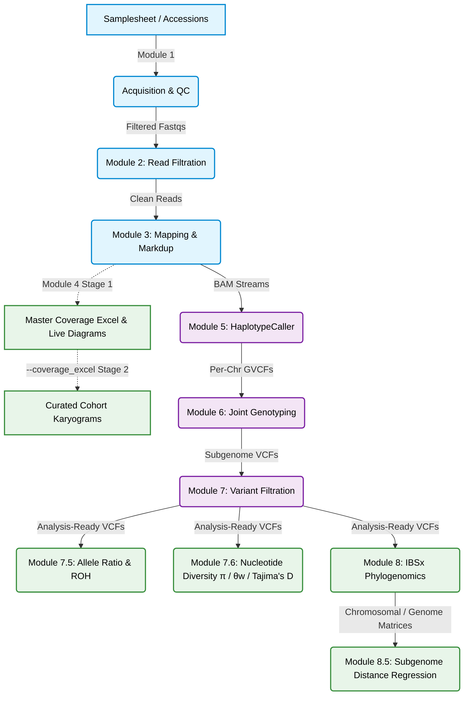

The updated `README.md` below incorporates the two-stage **Module 4 Coverage & Interactive Ploidy Curation** workflow (`lager_coverage_master.xlsx` + `--coverage_excel`), adds the Module 4 parameters to the `nextflow.config` block, and fixes the markdown links inside `git clone` and `LICENSE`:

```markdown
# Saccharomyces Genomics Pipeline

**A highly optimized Nextflow DSL2 workflow for population-scale WGS variant calling, interactive chromosomal coverage/ploidy curation, heterozygosity/ROH profiling, population nucleotide diversity, and phylogenomics of the *Saccharomyces sensu stricto* complex.**

[](https://www.nextflow.io/)
[](https://gatk.broadinstitute.org/)
[](https://samtools.github.io/bcftools/)
[](http://www.htslib.org/)
[](https://isocpp.org/)
[](https://www.r-project.org/)
[](https://www.python.org/)
[](https://docker.com)
[](https://doi.org/10.5281/zenodo.23289452)
[](#license)

[Pipeline Architecture](#pipeline-architecture) · [Quick Start](#quick-start) · [Standalone Shortcut Modes](#standalone-shortcut-modes) · [Configuration](#system-configuration) · [Module Documentation](#module-documentation)

---

## Overview

The **Saccharomyces Genomics Pipeline (v2.1.8)** is a production-grade bioinformatics workflow designed to process raw whole-genome sequencing (WGS) data into high-confidence variant calls, curated chromosomal copy-number/LOH landscapes, population diversity metrics, and evolutionary distance matrices.

Strictly adhering to GATK Best Practices, the pipeline is engineered to handle the complex genomic architectures of yeast, including dynamic organelle ploidies, rampant segmental aneuploidy, and multi-species hybridization, while maintaining high computational efficiency through memory-piped alignments, 8-chromosome parallel `bcftools`/`awk` streaming, and OpenMP-accelerated C++ backend processing.

### Core Capabilities

- **Subgenome Routing:** Automatically parses chromosomal prefixes via a configurable `species_map` (`c`, `e`, `p`, `m`, `k`, `u`, `a`, `j`) to route subgenomes (e.g., *S. cerevisiae*, *S. eubayanus*, *S. uvarum*, *S. kudriavzevii*) into isolated master VCFs, preventing cross-contamination in hybrid strains.
- **Dynamic Ploidy Resolution:** Utilizes a `ploidy_map` during GATK `HaplotypeCaller` execution to dynamically apply haploid models to mitochondrial (`_M`) and plasmid (`_P`) DNA while maintaining diploid models for nuclear chromosomes.
- **Zero-I/O Alignment:** Prevents massive intermediate disk writes by piping BWA-MEM alignments directly into SAMtools coordinate sorting (`bwa mem | samtools view -Sb | samtools sort`).
- **Two-Stage Interactive Coverage & Ploidy Curation:** Aggregates sliding-window read depths into a color-coded, formula-driven Master Excel Workbook (`lager_coverage_master.xlsx`) featuring live embedded subgenome bar charts (`Interactive_Plotter` & `Diagram2`), dynamic `G22` baseline and `G24` ploidy controls across 1–8 species, and automated chimeric breakpoint detection—followed by one-command batch karyogram rendering (`--coverage_excel`) once ploidies are curated.
- **Incremental Joint Genotyping:** Features the ability to inject newly sequenced strains into historical `GenomicsDB` workspaces without the computational overhead of re-importing legacy data.
- **Parallel Allele Ratio & ROH Profiling:** Streams filtered cohort VCFs in 8-chromosome parallel batches via `bcftools roh` and `bcftools query` to generate genome-wide B-Allele Frequency (BAF) and Loss of Heterozygosity (LOH/ROH) karyograms per strain and subgenome.
- **Multi-Clade Nucleotide Diversity ($\pi$, $\theta_W$, Tajima's $D$):** Computes missing-data-aware sliding-window and chromosome-wide Nucleotide Diversity ($\pi$), Watterson's Theta ($\theta_W$), and Tajima's $D$, supporting single-pass stratification across user-defined clades (e.g., `Saaz`, `Frohberg`, `Hybrids`, `Novalager`).
- **Vectorized Phylogenomics & Subgenome Divergence Regression:** Converts VCFs into vectorized allele tables via `awk` to feed an OpenMP R/C++ Identity-by-State (IBS) engine, followed by length-weighted 16-chromosome matrix aggregation, OLS linear regression, and 1,000-permutation Mantel testing across co-resident subgenomes.

---

## Pipeline Architecture

The workflow is constructed from modular Nextflow DSL2 sub-workflows, ensuring robust error handling, scatter-gather parallelization, and precise resource allocation across both full end-to-end runs and standalone shortcut executions.



---

## Quick Start

### 1. Prerequisites

Ensure you have [Nextflow](https://www.nextflow.io/) (`>=23.10.0`) and a container engine (Docker, Singularity, or Conda) installed.

```bash
git clone [https://github.com/hanzala-14/saccharomyces-genomics-pipeline.git](https://github.com/hanzala-14/saccharomyces-genomics-pipeline.git)
cd saccharomyces-genomics-pipeline

```

### 2. Prepare the Samplesheet

Create a `samplesheet_new.csv` file. The pipeline natively supports the concurrent processing of local FASTQ paths and public ENA/SRA accessions.

```csv
strain_id,accession,r1,r2
Strain_A,SRR1234567,,
Strain_B,,/data/local_R1.fastq.gz,/data/local_R2.fastq.gz

```

### 3. Execute the Full Pipeline

Run the workflow using the software profile that matches your computational environment. All tool dependencies are strictly pinned in `nextflow.config` to guarantee reproducibility.

```bash
# Local Workstation (Docker)
nextflow run main.nf -profile docker

# HPC Cluster (Singularity)
nextflow run main.nf -profile singularity

# Local Environment (Conda)
nextflow run main.nf -profile conda

```

---

## Standalone Shortcut Modes

In addition to end-to-end execution from raw reads, the pipeline provides four **Standalone Shortcut Modes** to run downstream profiling directly on existing outputs without re-running upstream modules:

### Mode A: Standalone Coverage Profiling & Interactive Ploidy Curation

Supports a two-stage human-in-the-loop workflow: **Stage 1** builds the formula-driven `lager_coverage_master.xlsx` workbook (with live subgenome diagrams on `Interactive_Plotter` and `Diagram2` for manual `G24` ploidy curation alongside `allele_roh` plots), and **Stage 2** batch-renders all cohort PNG/PDF karyograms directly from your saved Excel file:

```bash
# Stage 1: Generate the formula-driven Master Excel Workbook (with live embedded diagrams)
nextflow run main.nf -profile docker \
  --coverage_input_dir path/to/slidingwindow_tabs/ \
  --only_coverage true \
  --outdir results_coverage_stage1

# Stage 2: Batch-render all cohort karyograms from your curated Excel workbook
nextflow run main.nf -profile docker \
  --coverage_input_dir path/to/slidingwindow_tabs/ \
  --coverage_excel results_coverage_stage1/04_coverage/summary/lager_coverage_master.xlsx \
  --only_coverage true \
  --outdir results_coverage_stage2

```

### Mode B: Standalone Subgenome Pairwise Distance Regression

Run directly on a `Phylogeny/Distance_Matrices` directory (automatically combines `I`–`XVI` chromosomal matrices weighted by nuclear chromosome length) or a pre-compiled pairwise CSV:

```bash
# From a directory of IBSx distance matrices
nextflow run main.nf -profile docker \
  --matrix_input_dir path/to/Phylogeny/Distance_Matrices \
  --outdir results_subgenome_comp

# From an existing pairwise comparison CSV
nextflow run main.nf -profile docker \
  --comparison_csv path/to/Lager_Comparison.csv \
  --outdir results_subgenome_comp

```

### Mode C: Standalone Allele Ratio & ROH Profiling

Run directly on a folder of `.vcf.gz` files, optionally filtering to a specific `.txt` list of strains:

```bash
nextflow run main.nf -profile docker \
  --vcf_input_dir data/Final_Merged \
  --only_allele_roh true \
  --target_strains mystrains.txt \
  --outdir results_allele_roh

```

### Mode D: Standalone Nucleotide Diversity ($\pi$, $\theta_W$, Tajima's $D$)

Supports full cohorts, a single-clade `.txt` strain list with `--clade_name`, or a 2-column clade map (`Strain <tab> Clade`) to stratify multiple clades (e.g., `Saaz Clade`, `Frohberg Clade`, `Hybrids`, `Novalager`) in one pass:

```bash
# Single clade with custom plot header
nextflow run main.nf -profile docker \
  --vcf_input_dir data/Final_Merged \
  --only_diversity true \
  --target_strains saaz_strains.txt \
  --clade_name "Saaz Clade" \
  --outdir results_diversity_saaz

# Multi-clade single-pass execution (2-column Strain + Clade TSV/TXT)
nextflow run main.nf -profile docker \
  --vcf_input_dir data/Final_Merged \
  --only_diversity true \
  --target_strains clades_map.tsv \
  --outdir results_diversity_all_clades

```

---

## System Configuration

Pipeline execution is centrally managed via `nextflow.config`. Key parameters allow for precise control over hardware allocation, taxonomy dictionaries, and algorithmic thresholds.

```groovy
params {
    // I/O & Execution
    samplesheet              = 'samplesheet_new.csv'
    outdir                   = 'results'
    batch_size               = 50            // Throttles RAM usage during GenomicsDB import
    ibs_block_rows           = 8192          // C++ Matrix RAM chunking

    // Biology & Taxonomy
    ploidy                   = 2             // Default nuclear ploidy
    ploidy_map               = [ 'M': 1, 'P': 1 ] // Overrides for Mitochondria and Plasmids
    repetitive_intervals     = 'data/repititive_intervals/sensustricto8.repetitive.intervals'

    // Universal Sensu Stricto Routing Dictionary
    species_map = [
        'c': 'cerevisiae',   'e': 'eubayanus', 'p': 'paradoxus',  'm': 'mikatae',
        'k': 'kudriavzevii', 'u': 'uvarum',    'a': 'arboricola', 'j': 'jurei'
    ]

    // Module 4: Coverage Profiling & Two-Stage Ploidy Curation
    run_coverage             = true
    coverage_input_dir       = null          // Folder of *.slidingwindow.tab files for Mode A
    only_coverage            = false         // Run only Module 4
    coverage_excel           = null          // Path to curated lager_coverage_master.xlsx for Stage 2 plotting
    ploidy_multiplier        = 2.0           // Default initial G24 ploidy multiplier
    auto_adjust_ploidy       = true          // Auto-set initial G24 = 1.0 when median(e_) / median(c_) >= 1.8

    // Downstream Profiling Toggles & Sliding-Window Settings
    run_allele_roh           = true
    run_diversity            = true
    pi_window_size           = 10000         // 10 kb sliding window for π, θw, and Tajima's D
    pi_step_size             = 5000          // 5 kb step size
    run_phylogeny            = true
    run_subgenome_comp       = true
    target_strains           = null          // Optional 1-col strain list, 2-col clade map, or comma list
    clade_name               = null          // Optional clade label for plot titles
    exclude_outlier_strains  = ['WY1187', 'Udeb-LY0004']
}

```

### Incremental GenomicsDB Updates

To safely append newly sequenced strains to an existing `GenomicsDB` without rebuilding the entire dataset:

```bash
nextflow run main.nf \
  --samplesheet new_strains.csv \
  --genomicsdb_update_path "/path/to/historical/Joint_Genotyping" \
  -profile singularity -resume

```

---

## Directory Structure

```text
saccharomyces-genomics-pipeline/
├── bin/
│   ├── build_tree.R                   # Phylogenetic tree reconstruction script
│   ├── compare_subgenomes.py          # Multi-species OLS/Mantel regression & XLSX engine
│   ├── ibs_from_bin_single_omp.cpp    # OpenMP C++ pairwise IBS distance matrix engine
│   ├── ibs_pipeline.R                 # IBS orchestration pipeline
│   ├── ibs_utils.R                    # Helper utilities for allele matrix processing
│   ├── plot_allele_roh.R              # High-resolution BAF & ROH karyogram plotter
│   ├── plot_coverage.R                # Curated multi-subgenome coverage karyogram plotter
│   ├── plot_nucleotide_diversity.R    # Sliding-window π, θw, Tajima's D & clade boxplotter
│   ├── run_ibs.R                      # CLI wrapper for C++/R IBS calculation
│   ├── summarize_coverage.py          # Formula-driven OpenXML coverage dashboard & chart engine
│   └── tsv_to_u8bin.cpp               # Fast C++ allele TSV to binary converter
├── modules/
│   ├── download_raw.nf                # Module 1 (aria2c / fasterq-dump / QC)
│   ├── filter_reads.nf                # Module 2 (fastp)
│   ├── map_reads.nf                   # Module 3 (bwa-mem / samtools markdup)
│   ├── coverage.nf                    # Module 4 (bedtools / interactive Excel / curated karyograms)
│   ├── haplotype_calling.nf           # Module 5 (GATK HaplotypeCaller)
│   ├── joint_genotyping.nf            # Module 6 (GATK GenomicsDBImport / GenotypeGVCFs)
│   ├── variant_filtration.nf          # Module 7 (GATK VariantFiltration)
│   ├── allele_roh.nf                  # Module 7.5 (bcftools roh / BAF profiling)
│   ├── phylogenomy.nf                 # Module 8 (bcftools / awk / OpenMP C++ IBSx)
│   └── subgenome_diversity.nf         # Module 7.6 & 8.5 (Nucleotide diversity & Subgenome regression)
├── data/
│   ├── references/
│   ├── repititive_intervals/
│   └── slidingwindow/
├── docs/                              # Technical Module Specifications
├── nextflow.config
└── main.nf

```

---

## Module Documentation

For in-depth technical specifications, process signatures, and I/O contracts, refer to the module-specific documentation:

* 📥 [`MODULE_1: Data Acquisition & Validation`](https://github.com/hanzala-14/saccharomyces-genomics-pipeline/blob/main/docs/MODULE_1_DATA_ACQUISITION.md)
* 🧹 [`MODULE_2: Read Filtration`](https://github.com/hanzala-14/saccharomyces-genomics-pipeline/blob/main/docs/MODULE_2_FILTRATION.md)
* 🗺️ [`MODULE_3: Mapping & Duplicate Marking`](https://github.com/hanzala-14/saccharomyces-genomics-pipeline/blob/main/docs/MODULE_3_MAP_READS.md)
* 📊 [`MODULE_4: Coverage Profiling & Ploidy Curation`](https://github.com/hanzala-14/saccharomyces-genomics-pipeline/blob/main/docs/MODULE_4_GENOME_COVERAGE.md)
* 🧬 [`MODULE_5: Haplotype Calling`](https://github.com/hanzala-14/saccharomyces-genomics-pipeline/blob/main/docs/MODULE_5_HAPLOTYPE_CALLING.md)
* 🧩 [`MODULE_6: Joint Genotyping`](https://github.com/hanzala-14/saccharomyces-genomics-pipeline/blob/main/docs/MODULE_6_JOINT_GENOTYPING.md)
* ✂️ [`MODULE_7: Variant Filtration`](https://github.com/hanzala-14/saccharomyces-genomics-pipeline/blob/main/docs/MODULE_7_VARIANT_FILTRATION.md)
* 📈 [`MODULE_7.5: Allele Ratio & ROH Profiling`](https://github.com/hanzala-14/saccharomyces-genomics-pipeline/blob/main/docs/MODULE_7_5_ALLELE_ROH.md)
* 🌳 [`MODULE_8: Phylogenomics & Matrices`](https://github.com/hanzala-14/saccharomyces-genomics-pipeline/blob/main/docs/MODULE_8_PHYLOGENOMICS.md)
* 🔬 [`MODULE_9: Subgenome Divergence & Nucleotide Diversity`](https://github.com/hanzala-14/saccharomyces-genomics-pipeline/blob/main/docs/MODULE_9_SUBGENOME_DIVERSITY.md)

---

## Citation & Code Availability

If this pipeline is utilized in your research, please cite the exact release version via Zenodo alongside the forthcoming manuscript:

> Code availability: **Saccharomyces Genomics Pipeline v2.1.8**. GitHub: `hanzala-14/saccharomyces-genomics-pipeline`. DOI: [10.5281/zenodo.23289452](https://doi.org/10.5281/zenodo.23289452)

## License

This software is released under the **MIT License**. See the [LICENSE](https://www.google.com/search?q=LICENSE) file for comprehensive details.

```

```