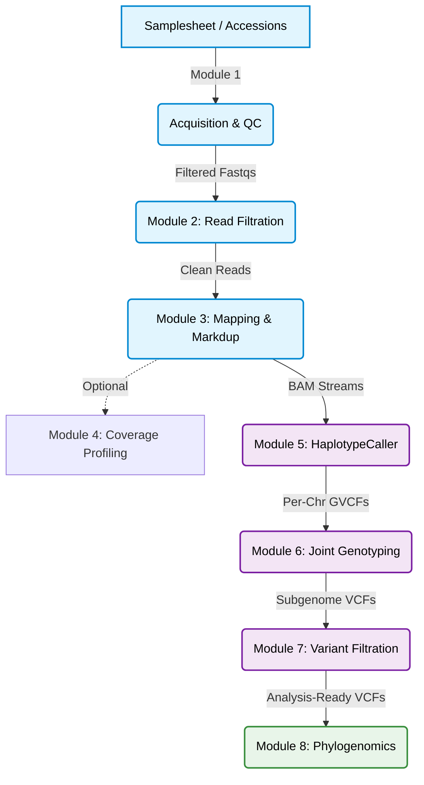

---
<div align="center">

```
 ███████╗ ██████╗██████╗ 
 ██╔════╝██╔════╝██╔══██╗
 ███████╗██║     ██████╔╝
 ╚════██║██║     ██╔═══╝ 
 ███████║╚██████╗██║     
 ╚══════╝ ╚═════╝╚═╝     
 SACCHAROMYCES GENOMICS PIPELINE

```

**A highly optimized Nextflow DSL2 workflow for population-scale WGS variant calling and phylogenomics of the *Saccharomyces sensu stricto* complex.**

[Overview](https://www.google.com/search?q=%23overview) · [Pipeline Architecture](https://www.google.com/search?q=%23pipeline-architecture) · [Quick Start](https://www.google.com/search?q=%23quick-start) · [Configuration](https://www.google.com/search?q=%23configuration) · [Module Documentation](https://www.google.com/search?q=%23module-documentation)

---

## Overview

The **Saccharomyces Genomics Pipeline (v2.1.8)** is a production-grade bioinformatics workflow designed to process raw whole-genome sequencing (WGS) data into high-confidence variant calls and evolutionary distance matrices.

Strictly adhering to GATK Best Practices, the pipeline is engineered to handle the complex genomic architectures of yeast, including dynamic organelle ploidies and multi-species hybridization, while maintaining high computational efficiency through memory-piped alignments and OpenMP-accelerated C++ backend processing.

### Core Capabilities

* **Subgenome Routing:** Automatically parses chromosomal prefixes via a configurable `species_map` to route subgenomes (e.g., *S. cerevisiae*, *S. eubayanus*) into isolated master VCFs, preventing cross-contamination in hybrid strains.
* **Dynamic Ploidy Resolution:** Utilizes a `ploidy_map` during GATK `HaplotypeCaller` execution to dynamically apply haploid models to mitochondrial and plasmid DNA while maintaining diploid models for nuclear chromosomes.
* **Zero-I/O Alignment:** Prevents massive intermediate disk writes by piping BWA-MEM alignments directly into SAMtools coordinate sorting (`bwa mem | samtools view -Sb | samtools sort`).
* **Incremental Joint Genotyping:** Features the ability to inject newly sequenced strains into historical `GenomicsDB` workspaces without the computational overhead of re-importing legacy data.
* **Vectorized Phylogenomics:** Bypasses Java memory bottlenecks by converting VCFs into vectorized allele tables via `awk`, feeding an embedded R/C++ Identity-by-State (IBS) engine to calculate exact pairwise genetic distances.

---

## Pipeline Architecture

The workflow is constructed from 8 discrete, modular Nextflow sub-workflows, ensuring robust error handling, scatter-gather parallelization, and precise resource allocation.



---

## Quick Start

### 1. Prerequisites

Ensure you have [Nextflow](https://www.google.com/search?q=https://www.nextflow.io) (`>=23.10.0`) and a container engine (Docker, Singularity, or Conda) installed.

```bash
git clone https://github.com/hanzala-14/saccharomyces-genomics-pipeline.git
cd saccharomyces-genomics-pipeline

```

### 2. Prepare the Samplesheet

Create a `samplesheet_new.csv` file. The pipeline natively supports the concurrent processing of local FASTQ paths and public ENA/SRA accessions.

```csv
strain_id,accession,r1,r2
Strain_A,SRR1234567,,
Strain_B,,/data/local_R1.fastq.gz,/data/local_R2.fastq.gz

```

### 3. Execute the Pipeline

Run the workflow using the software profile that matches your computational environment. All tool dependencies are strictly pinned in `nextflow.config` to guarantee reproducibility.

```bash
# Local Workstation (Docker)
nextflow run main.nf -profile docker

# HPC Cluster (Singularity)
nextflow run main.nf -profile singularity

# Local Environment (Conda)
nextflow run main.nf -profile conda

```

---

## System Configuration

Pipeline execution is centrally managed via `nextflow.config`. Key parameters allow for precise control over hardware allocation, taxonomy dictionaries, and algorithmic thresholds.

```groovy
params {
    // I/O & Execution
    samplesheet              = 'samplesheet_new.csv'
    outdir                   = 'results'
    batch_size               = 50            // Throttles RAM usage during GenomicsDB import
    ibs_block_rows           = 8192          // C++ Matrix RAM chunking

    // Biology & Taxonomy
    ploidy                   = 2             // Default nuclear ploidy
    ploidy_map               = [ 'M': 1, 'P': 1 ] // Overrides for Mitochondria and Plasmids
    repetitive_intervals     = 'data/repititive_intervals/sensustricto8.repetitive.intervals'

    // Universal Sensu Stricto Routing Dictionary
    species_map = [
        'c': 'cerevisiae', 'e': 'eubayanus',    'p': 'paradoxus',  'm': 'mikatae',
        'k': 'kudriavzevii', 'u': 'uvarum',       'a': 'arboricola', 'j': 'jurei'
    ]
}

```

### Incremental GenomicsDB Updates

To safely append newly sequenced strains to an existing `GenomicsDB` without rebuilding the entire dataset:

```bash
nextflow run main.nf \
  --samplesheet new_strains.csv \
  --genomicsdb_update_path "/path/to/historical/Joint_Genotyping" \
  -profile singularity -resume

```

---

## Directory Structure

```text
saccharomyces-genomics-pipeline/
├── bin/
│   ├── run_ibs.R               # R interface for distance calculation
│   └── ibs_engine.cpp          # OpenMP C++ distance matrix engine
├── modules/
│   ├── download_raw.nf         # Module 1 (aria2c / fasterq-dump)
│   ├── filter_reads.nf         # Module 2 (fastp)
│   ├── map_reads.nf            # Module 3 (bwa-mem / samtools markdup)
│   ├── coverage.nf             # Module 4 (bedtools)
│   ├── haplotype_calling.nf    # Module 5 (gatk HaplotypeCaller)
│   ├── joint_genotyping.nf     # Module 6 (gatk GenomicsDB / GenotypeGVCFs)
│   ├── variant_filtration.nf   # Module 7 (gatk VariantFiltration)
│   └── phylogenomy.nf          # Module 8 (bcftools / awk / C++)
├── data/
│   ├── references/             
│   ├── repititive_intervals/   
│   └── slidingwindow/          
├── docs/                       # Technical Specifications
├── nextflow.config             
└── main.nf                     

```

---

## Module Documentation

For in-depth technical specifications, process signatures, and I/O contracts, refer to the module-specific documentation:

* 📥 [`MODULE_1: Data Acquisition & Validation`](https://www.google.com/search?q=docs/MODULE_1_DATA_ACQUISITION.md)
* 🧹 [`MODULE_2: Read Filtration`](https://www.google.com/search?q=docs/MODULE_2_READ_FILTRATION.md)
* 🗺️ [`MODULE_3: Mapping & Duplicate Marking`](https://www.google.com/search?q=docs/MODULE_3_MAP_READS.md)
* 📊 [`MODULE_4: Coverage Profiling`](https://www.google.com/search?q=docs/MODULE_4_COVERAGE.md)
* 🧬 [`MODULE_5: Haplotype Calling`](https://www.google.com/search?q=docs/MODULE_5_HAPLOTYPE_CALLING.md)
* 🧩 [`MODULE_6: Joint Genotyping`](https://www.google.com/search?q=docs/MODULE_6_JOINT_GENOTYPING.md)
* ✂️ [`MODULE_7: Variant Filtration`](https://www.google.com/search?q=docs/MODULE_7_VARIANT_FILTRATION.md)
* 🌳 [`MODULE_8: Phylogenomics & Matrices`](https://www.google.com/search?q=docs/MODULE_8_PHYLOGENY.md)

---

## Citation & Code Availability

If this pipeline is utilized in your research, please cite the exact release version via Zenodo alongside the forthcoming manuscript:

> Akbar, M. H., Pfliegler, V., et al. (2026). *[Manuscript Title in Prep]*. [Journal Name].
> Code availability: **Saccharomyces Genomics Pipeline v2.1.8**. GitHub: `hanzala-14/saccharomyces-genomics-pipeline`. DOI: [10.5281/zenodo.XXXXXXX](https://www.google.com/search?q=https://doi.org/10.5281/zenodo.XXXXXXX)

## License

This software is released under the **MIT License**. See the [LICENSE](https://www.google.com/search?q=LICENSE) file for comprehensive details.

**Developed at the University of Debrecen**

Yeast Genomics Lab