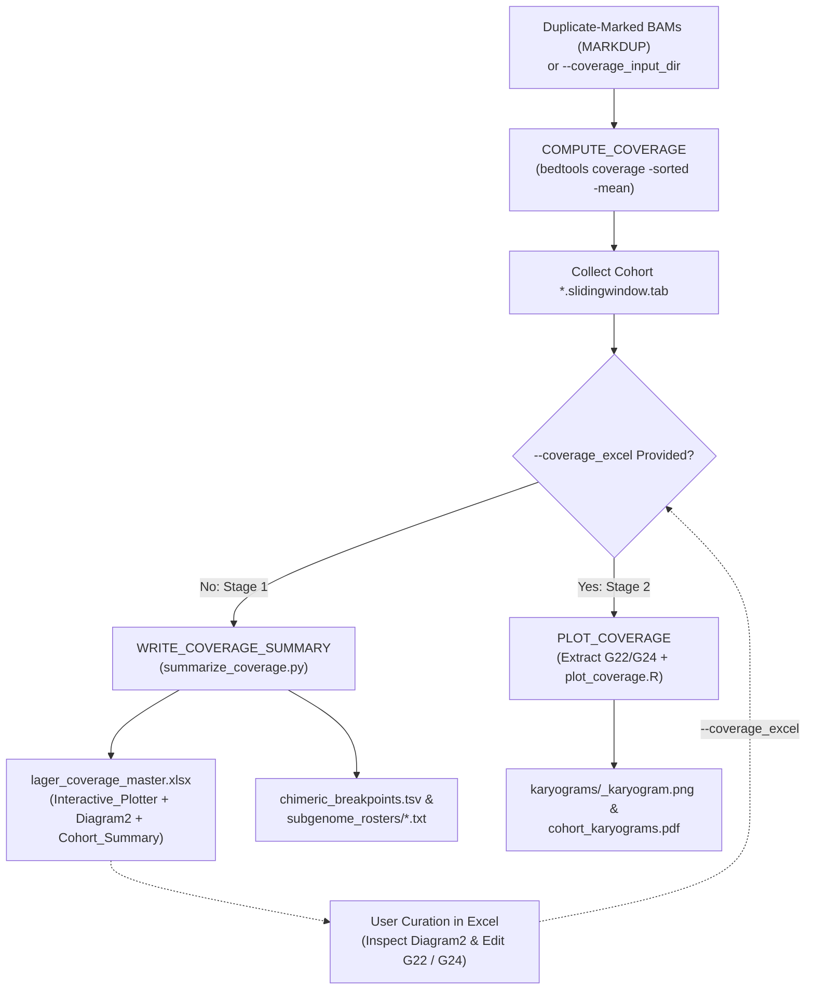

---

# 📖 Module 4: Sliding-Window Genome Coverage & Interactive Ploidy Curation

- **Repository:** `hanzala-14/saccharomyces-genomics-pipeline`
- **Module Source:** `modules/coverage.nf`
- **Workflow Source:** `main.nf`
- **Pipeline Configuration:** `nextflow.config`
- **Pipeline Version:** `2.1.4`
- **Last Updated:** 05 November 2026

---

## 1) Purpose & Scope

Module 4 quantifies chromosomal copy-number variation (CNV), whole-chromosome aneuploidy, interspecific subgenome stoichiometry, and chimeric translocation breakpoints across pure isolates and complex *Saccharomyces sensu stricto* hybrids.

Because polyploid and aneuploid Lager hybrids (*S. pastorianus* Group I Saaz, Group II Frohberg, Novalager, and synthetic hybrids) undergo extensive Loss of Heterozygosity (ROH) and chromosomal rearrangements, fully automated ploidy callers frequently misidentify baseline ploidy states. Module 4 implements a **Two-Stage Human-in-the-Loop Architecture** across three processes:

1. **`COMPUTE_COVERAGE`:** Streams coordinate-sorted, duplicate-marked BAMs through `bedtools coverage` to calculate raw mean read depth across genomic sliding windows.
2. **`WRITE_COVERAGE_SUMMARY` (Stage 1 — Master Workbook Generation):** Aggregates cohort-wide sliding-window depths into a formula-driven, color-coded OpenXML workbook (`lager_coverage_master.xlsx`) featuring live embedded subgenome bar charts (`Interactive_Plotter` and `Diagram2`), automatic chimeric breakpoint detection, and subgenome callable rosters.
3. **`PLOT_COVERAGE` (Stage 2 — Curated Batch Karyogram Rendering):** Reads the user-curated `lager_coverage_master.xlsx` workbook (`--coverage_excel`), extracts each strain's verified `G22` baseline depth and `G24` ploidy multiplier, and batch-renders high-resolution chromosomal karyograms.

---

## 2) Design Principles

### 2.1 Two-Stage Human-in-the-Loop Ploidy Curation (`G22` & `G24`)

In interspecific yeast hybrids, converting raw sequencing depth into absolute chromosomal copy number ($1n, 2n, 3n, 4n$) requires two strain-specific parameters:
$$\text{Copy Number} = \left(\frac{\text{Window Raw Depth}}{G22 \text{ (1x Baseline Depth)}}\right) \times G24 \text{ (Ploidy Multiplier)}$$

- **Stage 1 (Automated Aggregation & Initial Estimation):** `summarize_coverage.py` computes an initial dynamic nuclear baseline (`G22`) and optional subgenome-ratio adjustment (`--auto-adjust-ploidy`) while leaving all normalized values as **live Excel formulas**.
- **Interactive Curation:** Researchers inspect each strain alongside Module 7.5 (`allele_roh`) B-Allele Frequency plots and update `G24` (or `G22`) in Excel, watching the embedded chromosomal bar charts and cohort heatmap recalculate instantaneously.
- **Stage 2 (Curated Batch Plotting):** Passing the saved `.xlsx` file back via `--coverage_excel` allows `PLOT_COVERAGE` to render all cohort PNG and PDF karyograms using the exact human-verified ploidy multipliers.

### 2.2 Zero-Dependency OpenXML Formula & Live Diagram Engine

Standard Python/R container images often lack heavy Excel charting libraries (`openpyxl` or `xlsxwriter`), and static spreadsheets force users to manually rebuild charts for every strain.

- `summarize_coverage.py` constructs native OpenXML (`xl/worksheets/`, `xl/charts/`, `xl/drawings/`, `xl/styles.xml`) using only Python's standard library (`zipfile` and `xml.etree.ElementTree`).
- **Dual Input Modes on `Interactive_Plotter`:** Users can either type any `Strain_ID` into cell **`G20`** (which auto-loads that strain's sliding windows via `INDEX/MATCH`) or paste raw coverage numbers directly into **Column E (`Manual_Paste_Override`)**.
- **Embedded Subgenome Diagrams:** Automatically embeds live *S. cerevisiae* (blue), *S. eubayanus* (green), and additional subgenome bar charts with 16 vertical dashed chromosome dividers and Roman numeral labels (`I`–`XVI`) directly on `Interactive_Plotter` and on a full-width `Diagram2` tab.

### 2.3 Dynamic 1-to-8 *Sensu Stricto* Subgenome Scaling & Introgression Preservation

The module scales dynamically across all 8 *Saccharomyces sensu stricto* species (`c`, `e`, `p`, `m`, `k`, `u`, `a`, `j`):

- **Multi-Tier Dashboard Tables:** `Interactive_Plotter` groups all present species into color-coded 2-species tiers in `Columns F:K` (`Rows 4–19` for Tier 1, `Rows 34–103` for Tiers 2–4), computing live nuclear chromosome medians, copy numbers, and mitochondrial (`_M`) / 2-micron plasmid (`_P`) haploid copy numbers.
- **Segmental Introgression Retention:** In `plot_coverage.R`, a subgenome is retained for plotting if it contains $\ge 1$ active chromosome **or** $\ge 8$ sliding windows above the dynamic noise threshold (`max(5.0, 0.20 * Q75)`), ensuring subtelomeric introgressions from minor donor species are never stripped.
- **Canonical Subgenome Ordering:** `plot_coverage.R` locks `facet_wrap` panel levels to the exact order defined in `params.species_map` rather than alphabetical order.

### 2.4 Automated Chimeric Breakpoint Detection & Subgenome Rosters

Interspecific hybrids frequently harbor non-reciprocal translocations between homoeologous chromosomes, creating sharp step-changes in read depth.

- `summarize_coverage.py` smooths normalized nuclear window depths with a 5-window rolling median and scans adjacent 5-window flanks for step transitions ($\Delta \ge 0.75\times$), deduplicating hits within 25 kb into `chimeric_breakpoints.tsv`.
- Simultaneously emits per-species callable sample rosters (`subgenome_rosters/callable_samples_<prefix>.txt`) for any strain carrying $\ge 3$ active nuclear chromosomes in a given subgenome.

### 2.5 Container Symlink Hardening (`stageInMode 'copy'`)

Both `WRITE_COVERAGE_SUMMARY` and `PLOT_COVERAGE` enforce `stageInMode 'copy'` to physically stage scripts from `bin/` and input files into the container work directory, eliminating broken host symlink errors inside Docker and Singularity.

---

## 3) End-to-End Workflow



---

## 4) Input Contract (Operational)

### 4.1 `COMPUTE_COVERAGE` Inputs

* **Alignment Stream:** `tuple val(sample_id), path(bam), path(bai)`
* **Reference Coordinates:** `path genome_file` (`params.genome_file`) and `path windows_bed` (`params.sliding_windows`)

### 4.2 `WRITE_COVERAGE_SUMMARY` Inputs

* **Window Files:** `path window_files` (collected `*.slidingwindow.tab` files)
* **Script Stream:** `path bin_dir` (`${projectDir}/bin`)
* **Configuration Values:** `val species_map_str`, `val ploidy_mult` (`params.ploidy_multiplier`), and `val auto_adjust` (`params.auto_adjust_ploidy`)

### 4.3 `PLOT_COVERAGE` Inputs

* **Window Files:** `path window_files` (collected `*.slidingwindow.tab` files)
* **Curated Ploidy Source:** `path curated_source` (user-edited `lager_coverage_master.xlsx` or `.tsv`) and `val source_type` (`"xlsx"` or `"tsv"`)
* **Script & Taxonomy Inputs:** `path bin_dir`, `val species_map_str`, and `val ploidy_mult`

---

## 5) Process-by-Process Specification

### 5.1 `COMPUTE_COVERAGE`

**Role:** Calculate mean sequencing depth per genomic sliding window from coordinate-sorted BAM files.

* **Label:** `low`
* **Publish Path:** `${params.outdir}/04_coverage/sliding_windows`
* **Outputs:** `tuple val(sample_id), path("${sample_id}.slidingwindow.tab")` *(emit: sliding_window_cov)*

#### Execution Logic

1. Executes `bedtools coverage -sorted -g ${genome_file} -a ${windows_bed} -b ${bam} -mean` to stream coverage in $O(1)$ memory.
2. Emits a 4-column tab-delimited file (`chrom`, `start`, `end`, `mean_depth`) per sample.

### 5.2 `WRITE_COVERAGE_SUMMARY`

**Role:** Aggregate all cohort sliding-window files into the interactive, formula-driven Master Excel Workbook and ancillary QC tables.

* **Label:** `low`
* **Publish Path:** `${params.outdir}/04_coverage/summary`
* **Outputs:**
* `path "lager_coverage_master.xlsx"` *(emit: excel)*
* `path "chimeric_breakpoints.tsv"` *(emit: breakpoints)*
* `path "default_ploidy_table.tsv"` *(emit: ploidy_tsv)*
* `path "subgenome_rosters/*.txt"` *(emit: rosters, optional: true)*


#### Execution Logic

1. **Dynamic Baseline Calculation:** Computes per-chromosome medians and determines the active nuclear baseline (`G22`) and initial ploidy multiplier (`G24`).
2. **Breakpoint & Roster Extraction:** Scans nuclear chromosomes for copy-number step transitions (`chimeric_breakpoints.tsv`) and writes active sample lists per subgenome (`subgenome_rosters/`).
3. **OpenXML Workbook Construction:** Builds `lager_coverage_master.xlsx` with 7 structured sheets:
* `Interactive_Plotter`: Live single-strain workspace with `G20` strain selector, `Column E` manual override, `G22`/`G24` controls, color-coded chromosome/organellar tables (`Columns F:K`), and embedded subgenome bar charts.
* `Diagram2`: Full-screen live subgenome coverage charts with dashed chromosome dividers and Roman numeral labels.
* `Cohort_Chromosome_Summary`: Formula-driven cohort matrix where `Row 2` (`G22_Baseline`) and `Row 3` (`G24_Ploidy`) dynamically control all chromosomal copy numbers (`Rows 4+`) with 3-color conditional formatting.
* `Raw_Chromosome_Medians`: Unnormalized chromosome median depths feeding `Cohort_Chromosome_Summary`.
* `Raw_Sliding_Windows`: Complete cohort sliding-window matrix feeding `Interactive_Plotter`.
* `Baseline_QC_Metadata`: Per-strain baseline QC metrics and active chromosome lists.
* `Chimeric_Breakpoints`: Candidate intrachromosomal translocation/deletion coordinates.


### 5.3 `PLOT_COVERAGE`

**Role:** Extract curated `G22` and `G24` values from the saved Master Excel Workbook and batch-render individual and cohort-wide karyograms.

* **Label:** `phylogeny`
* **Publish Path:** `${params.outdir}/04_coverage/karyograms`
* **Outputs:**
* `path "karyograms/*.png"` *(emit: pngs)*
* `path "cohort_karyograms.pdf"` *(emit: pdf)*
* `path "applied_ploidy_settings.tsv"` *(emit: applied_settings)*


#### Execution Logic

1. **Ploidy Extraction:** Invokes `summarize_coverage.py --extract-curated-excel` to parse `Row 1` (`Sample_ID`), `Row 2` (`G22_Baseline`), and `Row 3` (`G24_Ploidy`) from `Cohort_Chromosome_Summary` inside the user's saved `.xlsx` file into `applied_ploidy_settings.tsv`.
2. **Karyogram Rendering:** Runs `Rscript plot_coverage.R` to filter each strain to its active nuclear subgenomes, normalize window depths using its curated `G22` and `G24` settings, and export individual PNGs (`karyograms/<strain>_karyogram.png`) and a multi-page cohort PDF (`cohort_karyograms.pdf`).

---

## 6) Configuration

In `nextflow.config`:

```groovy
params {
    // --- Module 4: Sliding-Window Coverage & Ploidy Curation ---
    run_coverage             = true
    genome_file              = 'data/references/sensustricto8.genome'
    sliding_windows          = 'data/slidingwindow/sensustricto8.10kb_5kb.bed'

    // Standalone Shortcut Mode A (Two-Stage Curation Workflow)
    coverage_input_dir       = null          // Directory containing *.slidingwindow.tab files
    only_coverage            = false         // Set true to run only Module 4
    coverage_excel           = null          // Path to curated lager_coverage_master.xlsx for Stage 2 plotting

    // Initial Baseline Ploidy Settings
    ploidy_multiplier        = 2.0           // Default initial G24 ploidy multiplier
    auto_adjust_ploidy       = true          // Auto-set initial G24 = 1.0 when median(e_) / median(c_) >= 1.8
}

```

### Standalone Execution Commands

```bash
# Stage 1: Generate the formula-driven Master Excel Workbook
nextflow run main.nf -profile docker \
  --coverage_input_dir data/Coverage \
  --only_coverage true \
  --outdir results_coverage_stage1

# Stage 2: Batch-render all cohort karyograms after curating G24 in Excel
nextflow run main.nf -profile docker \
  --coverage_input_dir data/Coverage \
  --coverage_excel results_coverage_stage1/04_coverage/summary/lager_coverage_master.xlsx \
  --only_coverage true \
  --outdir results_coverage_stage2

```

---

## 7) Output Layout

```text
results/
└── 04_coverage/
    ├── sliding_windows/
    │   ├── <sample_id>.slidingwindow.tab
    │   └── ...
    ├── summary/
    │   ├── lager_coverage_master.xlsx
    │   ├── chimeric_breakpoints.tsv
    │   ├── default_ploidy_table.tsv
    │   └── subgenome_rosters/
    │       ├── callable_samples_c.txt
    │       └── callable_samples_e.txt
    └── karyograms/                     # Generated in Stage 2 (--coverage_excel)
        ├── applied_ploidy_settings.tsv
        ├── cohort_karyograms.pdf
        └── karyograms/
            ├── <sample_id>_karyogram.png
            └── ...

```

---

## 8) Tool Reference

| Tool | Version | Purpose |
| --- | --- | --- |
| **Bedtools** | 2.30+ | Sorted sliding-window mean read depth calculation (`coverage -sorted -mean`). |
| **Python 3** | 3.11+ | Dynamic baseline computation, breakpoint detection, and native OpenXML `.xlsx` + chart generation. |
| **R (`tidyverse`)** | 4.3.1+ | Multi-subgenome chromosomal karyogram rendering (`plot_coverage.R`). |

*Table notes: All tools are pinned to isolated containers in `nextflow.config` (`quay.io/biocontainers/bedtools`, `quay.io/biocontainers/python:3.11`, and `rocker/tidyverse:4.3.1`).*

---

## 9) Change Management Rule

Any logic change affecting the OpenXML formula layout, `G22`/`G24` row indexing in `Cohort_Chromosome_Summary`, or R karyogram facet ordering must update:

1. `docs/MODULE_4_GENOME_COVERAGE.md` (this file)
2. `modules/coverage.nf`
3. `bin/summarize_coverage.py` and `bin/plot_coverage.R`

This guarantees implementation and documentation remain synchronized throughout pipeline development.

```

---

### Quick Update for `README.md` (Mode A Section)

In your `README.md` under **Standalone Shortcut Modes -> Mode A**, replace the Mode A snippet with both stages so readers immediately see the two-stage workflow:

```markdown
### Mode A: Standalone Coverage Profiling & Interactive Ploidy Curation
```bash
# Stage 1: Generate the formula-driven Master Excel Workbook (with live embedded diagrams)
nextflow run main.nf -profile docker \
  --coverage_input_dir path/to/slidingwindow_tabs/ \
  --only_coverage true \
  --outdir results_coverage_stage1

# Stage 2: Batch-render all cohort karyograms from your curated Excel workbook
nextflow run main.nf -profile docker \
  --coverage_input_dir path/to/slidingwindow_tabs/ \
  --coverage_excel results_coverage_stage1/04_coverage/summary/lager_coverage_master.xlsx \
  --only_coverage true \
  --outdir results_coverage_stage2

```

```