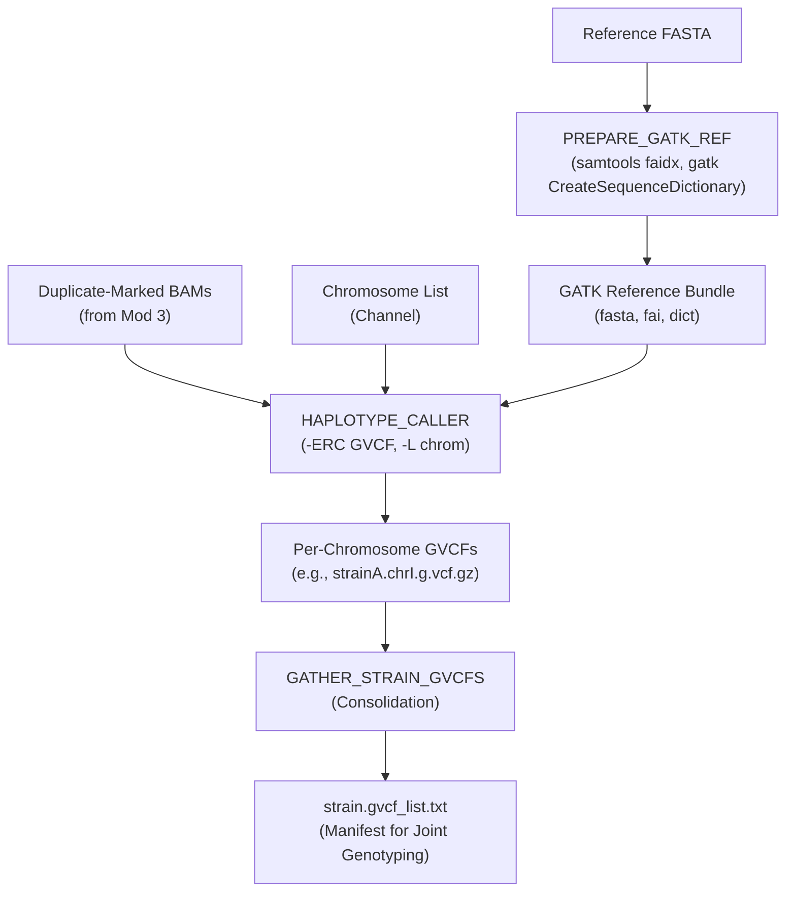

---

# 📖 Module 5: GATK HaplotypeCaller — Per-Chromosome GVCF Calling

* **Repository:** `hanzala-14/saccharomyces-genomics-pipeline`
* **Module Source:** `modules/haplotype_caller.nf` *(Assumed based on architecture)*
* **Workflow Source:** `main.nf`
* **Pipeline Configuration:** `nextflow.config`
* **Pipeline Version:** `2.1.5`
* **Last Updated:** 11 October 2026

---

## 1) Purpose & Scope

Module 5 executes high-accuracy variant discovery on the duplicate-marked BAM files using GATK's `HaplotypeCaller`. To achieve high performance, variant calling is scattered across individual chromosomes and emitted as Genomic VCFs (GVCFs).

It handles:

1. Preparation of the reference genome for GATK (generating `.dict` and `.fai` indices).
2. Highly parallelized, per-chromosome variant calling (`HaplotypeCaller`).
3. Dynamic ploidy resolution per-chromosome (e.g., differentiating between haploid mitochondrial DNA and diploid autosomal DNA).
4. Robust Java Virtual Machine (JVM) memory allocation and retry handling for Out-Of-Memory (OOM) exceptions.
5. Gathering of per-chromosome GVCFs into a unified strain-level manifest (`gvcf_list.txt`) to seamlessly feed into Module 6 (GenomicsDBImport & Joint Genotyping).

---

## 2) Design Principles

### 2.1 Scatter-Gather Parallelism

Instead of calling variants on the entire genome in a single monolithic task (which takes hours and bottlenecks the pipeline), the workload is scattered by chromosome (`-L ${chrom}`). This allows a single strain's variant calling to be processed concurrently across multiple CPU nodes, slashing total execution time.

### 2.2 Global Dynamic Ploidy Resolution

*Saccharomyces cerevisiae* genomes contain both diploid (or polyploid) autosomes and haploid mitochondrial DNA. To prevent false heterozygous calls on the mitochondrion, the process dynamically reads `params.ploidy_map` from the global configuration. By tokenizing the chromosome name (e.g., extracting the suffix `M` from `chr_M`), it assigns the biologically correct ploidy on the fly, falling back to a default `params.ploidy` if no specific mapping exists.

### 2.3 Safe JVM Memory Management

GATK is notorious for Java heap space crashes. The `HAPLOTYPE_CALLER` process dynamically reads the Nextflow `task.memory` directive, subtracts 20% for overhead, and securely injects the remaining memory into the JVM arguments (`-Xmx${avail_mem}g`). If an OOM kill still occurs (exit codes `137, 143, 247`), the task is natively caught by the `errorStrategy` and retried with increased resources.

### 2.4 The GVCF Paradigm

Rather than emitting direct VCFs, `HaplotypeCaller` is executed in `-ERC GVCF` mode. This produces a Genomic VCF containing confidence scores for both variant and non-variant sites, which is strictly required for accurate multi-sample joint genotyping in downstream modules.

---

## 3) End-to-End Workflow



---

## 4) Input Contract

### 4.1 Upstream Pipeline Channels

* **Reference Stream:** `path fasta`
* **Mapping Stream:** `tuple val(strain_id), path(bam), path(bai), val(chrom)`
* **Dynamic Params (Config):** `params.ploidy_map` and `params.ploidy`

---

## 5) Process Specification

### 5.1 `PREPARE_GATK_REF`

**Role:** Generate standard sequence dictionary and FASTA index required by GATK tools.

* **Label:** `medium`
* **Input:** `path fasta`
* **Output:** `tuple path(fasta), path("*.fai"), path("*.dict")` *(emit: gatk_ref)*
* **Execution Logic:**
* Executes `samtools faidx` to create the `.fai` file.
* Executes `gatk CreateSequenceDictionary` to generate the `.dict` file.


### 5.2 `HAPLOTYPE_CALLER`

**Role:** Discover variants and emit GVCFs for a specific chromosome of a specific strain.

* **Label:** `calling`
* **Error Strategy:** `retry` on `137` (OOM), `143` (SIGTERM), and `247`. Max retries: 2.
* **Input:** `tuple val(strain_id), path(bam), path(bai), val(chrom)` + `gatk_ref` tuple.
* **Output:** `tuple val(strain_id), val(chrom), path("${strain_id}.${chrom}.g.vcf.gz"), path("${strain_id}.${chrom}.g.vcf.gz.tbi")` *(emit: gvcf)*

#### Execution Logic

1. **Memory Calculation:** Extracts `task.memory.toGiga() * 0.8` to safely allocate `-Xmx` to Java.
2. **Ploidy Lookup:** Tokenizes `chrom` by underscore (`_`). Looks up the suffix in `params.ploidy_map`. If not found, defaults to `params.ploidy`.
3. **Execution:** Runs `gatk HaplotypeCaller` constrained to the specific chromosome (`-L ${chrom}`) and specific ploidy.
4. **Validation:** Checks if the GVCF was successfully produced; exits with `1` if empty.

### 5.3 `GATHER_STRAIN_GVCFS`

**Role:** Consolidate the scattered chromosome GVCFs back to the strain level and generate a manifest.

* **Label:** `tiny`
* **Publish Path:** `${params.outdir}/Haplotype_Calling/${strain_id}` (`mode: 'symlink'`)
* **Input:** `tuple val(strain_id), val(chroms), path(gvcfs), path(tbis)`
* **Outputs:**
* `tuple val(strain_id), path(gvcfs), path(tbis)` *(emit: strain_gvcfs)*
* `tuple val(strain_id), path("${strain_id}.gvcf_list.txt")` *(emit: gvcf_list)*


#### Execution Logic

* Takes an array of all per-chromosome GVCFs for a given strain, sorts them alphabetically, and writes their filenames into a flat text manifest (`${strain_id}.gvcf_list.txt`). This manifest acts as a direct input map for GenomicsDBImport in Module 6.

---

## 6) Configuration

In `nextflow.config`:

```groovy
params {
    // --- Module 5: Haplotype Calling ---
    
    // Default ploidy for standard yeast autosomes (Diploid)
    ploidy = 2 
    
    // Dynamic mapping for non-standard chromosomes (e.g., mitochondrial DNA is haploid)
    ploidy_map = [
        'M': 1, 
        'MT': 1
    ]
}

```

---

## 7) Output Layout

```text
results/
└── Haplotype_Calling/
    ├── <strain_A>/
    │   ├── strain_A.chr_I.g.vcf.gz
    │   ├── strain_A.chr_I.g.vcf.gz.tbi
    │   ├── strain_A.chr_II.g.vcf.gz
    │   ├── strain_A.chr_II.g.vcf.gz.tbi
    │   ├── ...
    │   └── strain_A.gvcf_list.txt     # Manifest for Mod 6
    └── <strain_B>/
        └── ...

```

---

## 8) Tool Reference

| Tool | Version (Min Recommended) | Purpose |
| --- | --- | --- |
| **GATK** | 4.2+ | FASTA dictionary generation and HaplotypeCaller GVCF variant discovery. |
| **Samtools** | 1.10+ | Fast indexing of the reference sequence (`faidx`). |

---

## 9) Change Management Rule

Any logic change affecting JVM memory handling, dynamic ploidy lookup mechanisms, or the GVCF manifest format must update:

1. `docs/MODULE_5_HAPLOTYPE_CALLING.md` (this file)
2. `modules/haplotype_caller.nf`
3. The Module 5 execution block in `main.nf`

This guarantees implementation and documentation remain synchronized throughout pipeline development.