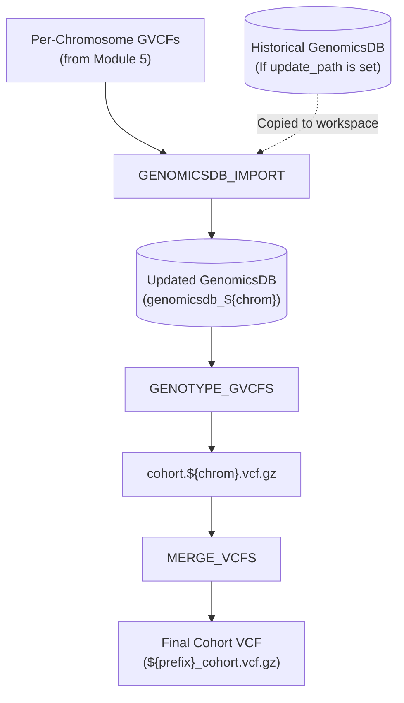

---

# 📖 Module 6: Joint Genotyping & GenomicsDB Construction

* **Repository:** `hanzala-14/saccharomyces-genomics-pipeline`
* **Module Source:** `modules/joint_genotyping.nf`
* **Workflow Source:** `main.nf`
* **Pipeline Configuration:** `nextflow.config`
* **Pipeline Version:** `2.1.6`
* **Last Updated:** 11 October 2026

---

## 1) Purpose & Scope

Module 6 orchestrates multi-sample Joint Genotyping, a cornerstone of the GATK Best Practices. By evaluating variant evidence across the entire cohort simultaneously, joint genotyping empowers the pipeline to distinguish true rare variants from sequencing artifacts and accurately assign `0/0` (homozygous reference) calls instead of "no-call" states.

It handles:

1. Dynamic aggregation of per-chromosome GVCFs into a highly scalable `GenomicsDB` data store.
2. **Incremental Database Expansion:** The ability to append new samples to a historical database without re-importing the entire compendium from scratch.
3. Chromosome-level joint variant calling (`GenotypeGVCFs`) to bypass single-node computational bottlenecks.
4. Final consolidation of scattered chromosomal VCFs into a unified, publication-ready cohort VCF (`MergeVcfs`).
5. Native circumvention of Nextflow directory-overwrite collisions via explicit local cache clearing.

---

## 2) Design Principles

### 2.1 Incremental Database Growth (The `update_path` Paradigm)

In large-scale yeast genomics, new strains are constantly sequenced over months or years. Module 6 checks the `update_path` variable. If a historical GenomicsDB exists, the module creates a read-only copy of it in the local workspace and utilizes `--genomicsdb-update-workspace-path` to inject only the new samples. If no path is provided, it seamlessly defaults to a `FRESH` build using `--genomicsdb-workspace-path`.

### 2.2 Nextflow Overwrite Safety Fix

`GenomicsDB` produces a complex directory structure rather than a single file. When Nextflow attempts to publish (`publishDir`) an updated database over an existing directory symlink, it frequently crashes. The `GENOMICSDB_IMPORT` script proactively executes `rm -rf "${target_publish_dir}"` on the local output destination just before completion, allowing Nextflow's `overwrite: true` directive to safely place the new database without corrupting the source compendium.

### 2.3 Scatter-Gather Architecture

GenomicsDB and GenotypeGVCFs are highly memory-intensive and do not multi-thread efficiently across an entire genome. By scattering the workload by chromosome (`chrom`), the pipeline can process the 16 yeast chromosomes concurrently across 16 different cluster nodes, reducing days of compute time down to hours.

### 2.4 Safe JVM Memory Management

GATK processes are wrapped with a dynamic memory calculation (`task.memory.toGiga() * 0.8`). This reserves 20% of the allocated container memory for native OS overhead, preventing silent container kills. Standard `errorStrategy` directives automatically catch and retry any residual `137` (OOM) or `143` (SIGTERM) exceptions.

---

## 3) End-to-End Workflow



---

## 4) Input Contract (Operational)

### 4.1 Upstream Pipeline Channels

* **GVCF Stream (from Mod 5):** `tuple val(chrom), path(gvcfs), path(tbis)`
* **Reference Stream:** `tuple path(fasta), path(fai), path(dict)`
* **External Configuration:** `val(update_path)` (Absolute path to historical DB directory, or `null` for a fresh run).

---

## 5) Process-by-Process Specification

### 5.1 `GENOMICSDB_IMPORT`

**Role:** Consolidate multiple GVCFs into a high-performance GenomicsDB workspace.

* **Label:** `high`
* **Publish Path:** `${params.outdir}/Joint_Genotyping/${chrom}` (`mode: 'symlink', overwrite: true`)
* **Error Strategy:** Retry on OOM (`137, 143, 247`). Max retries: 2.
* **Outputs:**
* `tuple val(chrom), path("genomicsdb_${chrom}")` *(emit: db)*
* `path("sample_map_${chrom}.txt")` *(emit: sample_map)*


#### Execution Logic

1. **Sample Map Generation:** Dynamically generates a standard GATK sample map (`strain_id \t absolute_path.gvcf`) from the input channel array.
2. **Mode Selection:**
* **INCREMENTAL:** Copies the historical DB from `update_path` and sets `IMPORT_FLAG="--genomicsdb-update-workspace-path"`.
* **FRESH:** Sets `IMPORT_FLAG="--genomicsdb-workspace-path"`.


3. **Execution:** Runs `gatk GenomicsDBImport` utilizing `params.batch_size` to control memory spikes when reading hundreds of files.
4. **Collision Prevention:** Clears the specific local output directory path to ensure Nextflow's symlink publisher can overwrite the old database cleanly.

### 5.2 `GENOTYPE_GVCFS`

**Role:** Perform joint variant calling across all samples within the GenomicsDB.

* **Label:** `high`
* **Publish Path:** `${params.outdir}/Joint_Genotyping/${chrom}` (pattern: `cohort.*`)
* **Error Strategy:** Retry on OOM (`137, 143, 247`). Max retries: 2.
* **Input:** `tuple val(chrom), path(workspace)` and the GATK Reference bundle.
* **Output:** `tuple val(chrom), path("cohort.${chrom}.vcf.gz"), path("cohort.${chrom}.vcf.gz.tbi")` *(emit: cohort_vcf)*

#### Execution Logic

* Mounts the input database directory using the URI syntax `-V "gendb://${workspace}"`.
* Executes `gatk GenotypeGVCFs` to evaluate the cohort and emit a unified VCF containing genotype calls (`0/0`, `0/1`, `1/1`, `./.`) and variant annotations for the specific chromosome.
* Checks that the output VCF is non-empty before reporting success.

### 5.3 `MERGE_VCFS`

**Role:** Recombine the scattered chromosomal VCFs into the final cohort deliverable.

* **Label:** `medium`
* **Publish Path:** `${params.outdir}/Joint_Genotyping/Final_Merged` (`mode: 'symlink', overwrite: true`)
* **Input:** `tuple val(prefix), path(vcfs), path(tbis)`
* **Output:** `tuple val(prefix), path("${prefix}_cohort.vcf.gz"), path("${prefix}_cohort.vcf.gz.tbi")` *(emit: final_vcf)*

#### Execution Logic

* Gathers all chromosomal VCFs generated by `GENOTYPE_GVCFS`.
* Formats them into an argument string (`-I chrI.vcf.gz -I chrII.vcf.gz ...`).
* Executes `gatk MergeVcfs` to generate the final, whole-genome cohort VCF ready for hard-filtering or VQSR.

---

## 6) Configuration

In `nextflow.config`:

```groovy
params {
    // --- Module 6: Joint Genotyping ---
    
    // Batch size controls memory usage during GVCF reading. 
    // Lower to 50 or 0 (un-batched) if encountering severe OOM issues.
    batch_size = 50 
    
    // Absolute path to a historical GenomicsDB directory for incremental updates
    // Set to null to perform a completely fresh database build.
    update_path = null 
}

```

---

## 7) Output Layout

```text
results/
└── Joint_Genotyping/
    ├── Final_Merged/
    │   ├── saccharomyces_cohort.vcf.gz
    │   └── saccharomyces_cohort.vcf.gz.tbi
    ├── chr_I/
    │   ├── genomicsdb_chr_I/            # The actual database structure
    │   ├── cohort.chr_I.vcf.gz
    │   └── cohort.chr_I.vcf.gz.tbi
    ├── chr_II/
    │   └── ...
    └── ...

```

---

## 8) Tool Reference

| Tool | Version (Min Recommended) | Purpose |
| --- | --- | --- |
| **GATK** | 4.2+ | `GenomicsDBImport`, `GenotypeGVCFs`, and `MergeVcfs`. |

---

## 9) Change Management Rule

Any logic change affecting the `update_path` incremental logic, directory overwrite safety checks, or batch sizing must update:

1. `docs/MODULE_6_JOINT_GENOTYPING.md` (this file)
2. `modules/joint_genotyping.nf`
3. The Module 6 execution block in `main.nf`

This guarantees implementation and documentation remain synchronized throughout pipeline development.