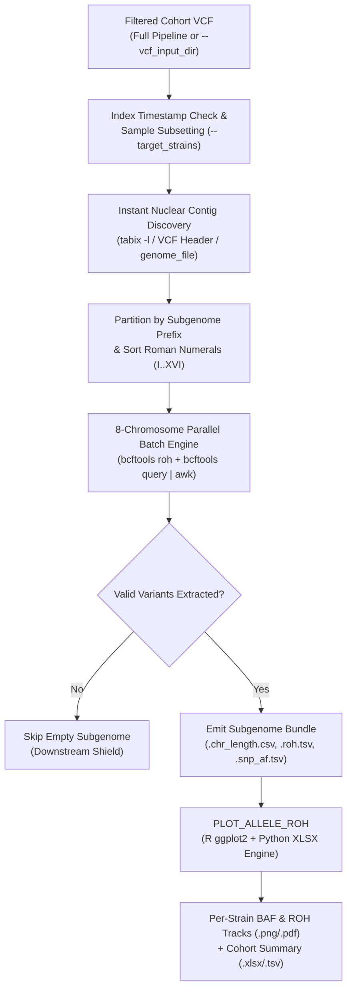

---


# 📖 Module 7.5: Allele Ratio & Runs of Homozygosity (ROH) Profiling

- **Repository:** `hanzala-14/saccharomyces-genomics-pipeline`
- **Module Source:** `modules/allele_roh.nf`
- **Workflow Source:** `main.nf`
- **Pipeline Configuration:** `nextflow.config`
- **Pipeline Version:** `2.1.9`
- **Last Updated:** 03 November 2026

---

## 1) Purpose & Scope

Module 7.5 evaluates chromosomal heterozygosity, copy-number / ploidy shifts via B-Allele Frequency (BAF), and Loss of Heterozygosity (LOH) architecture across pure isolates and interspecific *Saccharomyces sensu stricto* hybrids. It bridges the gap between filtered cohort VCFs and strain-level karyotype stability profiling.

It is divided into two distinct, high-performance processes:

1. **`EXTRACT_ALLELE_ROH`:** Rapidly subsets samples, discovers active nuclear chromosomes (`I`–`XVI`), and executes an 8-chromosome parallel streaming engine via `bcftools` and `awk` to extract site-level allelic depths (`AD`) and Hidden Markov Model (HMM) Runs of Homozygosity (`ROH`).
2. **`PLOT_ALLELE_ROH`:** Ingests the extracted chromosomal tables and executes a containerized R/Python reporting engine to render genome-wide BAF + ROH tracks and a multi-sheet cohort `.xlsx` workbook.

---

## 2) Design Principles

### 2.1 8-Chromosome Parallel Streaming & File-Descriptor Protection

Streaming `bcftools query` across all 16 chromosomes and >150 samples simultaneously inside a lightweight BusyBox/Bioconda container can exhaust OS file descriptors (`ulimit -n`), causing silent pipe truncations.

- **Batched Concurrency:** `EXTRACT_ALLELE_ROH` launches concurrent chromosome extraction subshells throttled strictly in batches of 8 (`if [ $((c_idx % 8)) -eq 0 ]; then wait; fi`), maximizing multi-core throughput while guaranteeing zero file-descriptor exhaustion.
- **Per-Chromosome Isolation:** Each chromosome writes to its own isolated temporary workspace before deterministic Roman-numeral concatenation, eliminating race conditions.

### 2.2 Universal *Sensu Stricto* Subgenome Partitioning

Interspecific hybrids (e.g., *S. pastorianus* carrying `c_` and `e_` subgenomes, or triple hybrids carrying `c_`, `u_`, and `k_`) require independent chromosomal coordinate spaces per subgenome.

- Automatically detects species prefixes (`c`, `e`, `p`, `m`, `k`, `u`, `a`, `j`) mapped in `params.species_map`.
- Strips extrachromosomal mitochondrial (`_M`) and 2-micron plasmid (`_P`) contigs.
- Sorts nuclear chromosomes strictly in canonical Roman numeral order (`I` through `XVI`).

### 2.3 On-the-Fly Sample Subsetting (`--target_strains`)

Re-genotyping or physically slicing a massive cohort VCF just to inspect a handful of strains wastes time and disk space. `EXTRACT_ALLELE_ROH` inspects `--target_strains` (accepting `"ALL"`, comma-separated strain IDs, or an external `.txt` file) and streams only the requested samples natively via `bcftools query -S` and `bcftools roh -S`.

### 2.4 Container Index Timestamp Hardening

When Nextflow stages `.vcf.gz` and `.vcf.gz.tbi` symlinks into an isolated container directory, the symlink creation timestamp of `.vcf.gz` can appear milliseconds newer than `.tbi`, causing `bcftools` to fail or emit stale-index warnings. The module automatically detects timestamp inversions (`[ "${vcf}" -nt "${vcf}.tbi" ]`), dereferences the index, and refreshes its timestamp prior to streaming.

### 2.5 Bypassing Docker Symlink Walls (`stageInMode`)

`PLOT_ALLELE_ROH` enforces `stageInMode 'copy'` and receives `ch_custom_scripts` (`bin/`) explicitly as a path channel, ensuring R and Python helper routines execute cleanly inside Docker and Singularity containers without broken host symlinks.

---

## 3) End-to-End Workflow



---

## 4) Input Contract (Operational)

### 4.1 `EXTRACT_ALLELE_ROH` Inputs

* **VCF Stream:** `tuple val(cohort_id), path(vcf), path(tbi)`
* **Fallback Reference Sizes:** `path genome_file` (`params.genome_file` or `NO_GENOME`)
* **Sample Filter Inputs:** `path target_strains_file` and `val target_strains_val`

### 4.2 `PLOT_ALLELE_ROH` Inputs

* **Extracted Bundle:** `tuple val(cohort_id), path(chr_len_files), path(roh_files), path(af_files), path(samples_file)`
* **Script Stream:** `path custom_scripts` (`${projectDir}/bin`)
* **Dictionary:** `val species_map_str` (serialized 8-species lookup string)

---

## 5) Process-by-Process Specification

### 5.1 `EXTRACT_ALLELE_ROH`

**Role:** Stream cohort VCFs in parallel across chromosomes to extract heterozygous/homozygous allelic ratios and HMM ROH tracts per strain and subgenome.

* **Label:** `medium`
* **Publish Path:** `${params.outdir}/08_allele_roh/${cohort_id}/extracted_data`
* **Outputs:**
* `tuple val(cohort_id), path("subgenomes/*/*.chr_length.csv"), path("subgenomes/*/*.roh.tsv"), path("subgenomes/*/*.snp_af.tsv"), path("samples.txt")` *(emit: extracted_bundle, optional: true)*


#### Execution Logic

1. **Index Verification:** Generates `.tbi` on the fly if missing, or refreshes `.tbi` if older than `.vcf.gz`.
2. **Sample Filtering:** Cross-references `params.target_strains` against `bcftools query -l` to build `samples.txt`.
3. **Contig Discovery:** Extracts nuclear chromosome lengths (`I`–`XVI`) from the VCF header (or `params.genome_file`) and active contigs via `tabix -l`.
4. **Parallel Streaming:** Launches 8-chromosome batches running `bcftools roh -G 30` and `bcftools query -f '%POS[\t%GT\t%AD]\n'` piped into `awk` to compute alternate allele fractions (`ALT_DP / (REF_DP + ALT_DP)`).

### 5.2 `PLOT_ALLELE_ROH`

**Role:** Render publication-ready genome-wide allele frequency ratio and ROH karyograms per strain and compile cohort-wide summary tables.

* **Label:** `phylogeny`
* **Publish Path:** `${params.outdir}/08_allele_roh/${cohort_id}`
* **Outputs:**
* `path "plots/*.png"` *(emit: pngs, optional: true)*
* `path "plots/*.pdf"` *(emit: pdfs, optional: true)*
* `path "cohort_allele_roh_summary.tsv"` *(emit: summary_tsv)*
* `path "cohort_allele_roh_summary.xlsx"` *(emit: summary_xlsx, optional: true)*


#### Execution Logic

1. **Physical Staging:** Enforces `stageInMode 'copy'` and stages chromosomal length, ROH, and AF tables into dedicated subdirectories (`chr_lens/`, `roh_tsvs/`, `af_tsvs/`).
2. **Rendering:** Invokes `Rscript plot_allele_roh.R` to plot concatenated chromosomes (`I`–`XVI`) with alternating background shading, ROH coverage bands, and heterozygous B-allele frequency scatter tracks (`0.0` to `1.0`).
3. **Multi-Sheet Export:** Generates `cohort_allele_roh_summary.tsv` and a multi-sheet `.xlsx` workbook summarizing total ROH length, genomic ROH fraction (`F_ROH`), and mean heterozygosity per strain and subgenome.

---

## 6) Configuration

In `nextflow.config`:

```groovy
params {
    // --- Module 7.5: Allele Ratio & ROH Profiling ---
    
    // Toggle Allele & ROH profiling ON/OFF in full pipeline runs
    run_allele_roh  = true
    
    // Standalone Shortcut Mode C: Folder containing *.vcf.gz files
    vcf_input_dir   = null
    only_allele_roh = false
    
    // Optional: comma-separated strain IDs OR path to a .txt file of target strains
    target_strains  = null
}

```

---

## 7) Output Layout

```text
results/
└── 08_allele_roh/
    └── <cohort_id>/
        ├── cohort_allele_roh_summary.tsv
        ├── cohort_allele_roh_summary.xlsx
        ├── extracted_data/
        │   ├── samples.txt
        │   └── subgenomes/
        │       ├── c/
        │       │   ├── c.chr_length.csv
        │       │   ├── c.roh.tsv
        │       │   └── c.snp_af.tsv
        │       └── e/
        │           ├── e.chr_length.csv
        │           ├── e.roh.tsv
        │           └── e.snp_af.tsv
        └── plots/
            ├── <strain_id>_cerevisiae_allele_roh.png
            ├── <strain_id>_cerevisiae_allele_roh.pdf
            ├── <strain_id>_eubayanus_allele_roh.png
            └── <strain_id>_eubayanus_allele_roh.pdf

```

---

## 8) Tool Reference

| Tool | Version (Min Recommended) | Purpose |
| --- | --- | --- |
| **Bcftools** | 1.19+ | HMM Runs of Homozygosity (`roh`) and fast genotype/allelic depth streaming (`query`). |
| **AWK** | N/A | Vectorized allelic depth (`AD`) parsing and B-allele fraction computation. |
| **R (`tidyverse`)** | 4.3.1+ | High-resolution chromosomal BAF and ROH track rendering. |
| **Python 3** | 3.10+ | Zero-dependency native XML `.xlsx` multi-sheet workbook generation. |

---

## 9) Change Management Rule

Any logic change affecting the `awk` allelic depth parsing, the parallel chromosome batching loop, or R plotting parameters must update:

1. `docs/MODULE_7_5_ALLELE_ROH.md` (this file)
2. `modules/allele_roh.nf`
3. `bin/plot_allele_roh.R`

This guarantees implementation and documentation remain synchronized throughout pipeline development.
