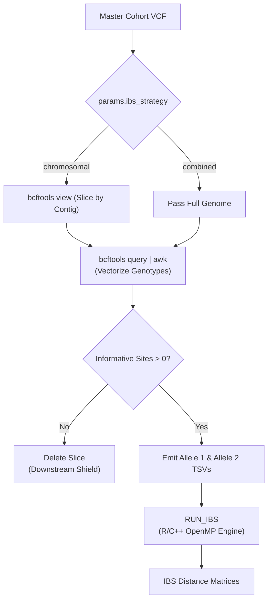

---

# 📖 Module 8: IBSx Phylogeny & Distance Matrices

* **Repository:** `hanzala-14/saccharomyces-genomics-pipeline`
* **Module Source:** `modules/phylogeny.nf`
* **Workflow Source:** `main.nf`
* **Pipeline Configuration:** `nextflow.config`
* **Pipeline Version:** `2.1.8`
* **Last Updated:** 11 October 2026

---

## 1) Purpose & Scope

Module 8 performs the critical transformation of raw genotypic data into mathematical distance matrices representing evolutionary relatedness. It bridges the gap between variant calling (VCFs) and downstream phylogenetic network reconstruction (e.g., SplitsTree or neighbor-joining trees).

It is divided into two distinct, high-performance processes:

1. **`PREP_ALLELES`:** Rapidly slices the master cohort VCF and vectorizes standard string genotypes (`0/0`, `0/1`, `1/1`) into split numerical Allele 1 and Allele 2 TSV matrices.
2. **`RUN_IBS`:** Ingests the vectorized allele tables and executes a custom, multi-threaded R/C++ engine to calculate Identity-By-State (IBS) distance matrices.

---

## 2) Design Principles

### 2.1 Dynamic VCF Slicing (The `ibs_strategy`)

Phylogenetic signals often vary across chromosomes (especially in yeast, where hybridization and introgression can affect specific linkage groups differently).

* **Chromosomal Mode:** `PREP_ALLELES` dynamically parses the VCF header, extracts all contigs, and slices the master VCF into individual chromosomes natively via `bcftools view`. This allows downstream network building to occur on a per-chromosome basis.
* **Combined Mode:** Passes the entire genome through as a single block.

### 2.2 Vectorized AWK Genotype Splitting

Standard VCF genotypes are not mathematically computable. `PREP_ALLELES` uses a highly optimized, vectorized `awk` script to split genotypes into independent `allele1` and `allele2` matrices.

* Normalizes phase states (`|` to `/`).
* Resolves missing data (`.` or `./.` to `..`).
* Sorts heterozygous calls deterministically so `0/1` and `1/0` are treated identically.

### 2.3 The "Downstream Shield"

Chromosomes with zero informative variants (e.g., highly conserved regions or completely filtered contigs) will cause the downstream C++ matrix engine to crash with a segmentation fault. `PREP_ALLELES` counts the informative sites post-extraction; if the count is `0`, it actively deletes the sub-directory and skips execution, shielding the R engine from fatal errors.

### 2.4 Bypassing Docker Symlink Walls (`stageInMode`)

Nextflow conventionally creates symlinks to script files in the work directory. However, when invoking custom C++ headers via R within a Docker container, relative symlinks outside the container mount path cause catastrophic "File Not Found" compilation errors. `RUN_IBS` forces `stageInMode 'copy'` to physically copy the source code into the execution directory, bypassing the Docker symlink wall.

### 2.5 OpenMP Core Hijacking Prevention

C++ matrix operations using OpenMP will natively attempt to consume every available CPU core on the HPC node, violating Nextflow's resource scheduler. The module explicitly exports `OMP_NUM_THREADS=${task.cpus}` to constrain the R/C++ engine to the exact core count allocated by Nextflow.

---

## 3) End-to-End Workflow



---

## 4) Input Contract (Operational)

### 4.1 `PREP_ALLELES` Inputs

* **Mapping Stream:** `tuple val(strain_id), path(master_vcf), path(master_tbi)`
* **Dynamic Params (Config):** `params.ibs_strategy` and `params.filter_monomorphic`

### 4.2 `RUN_IBS` Inputs

* **Data Stream:** `tuple val(strain_id), path(samples), path(allele1), path(allele2)`
* **Script Stream:** `path custom_scripts` (A directory channel containing `run_ibs.R` and associated `.cpp` source files).

---

## 5) Process-by-Process Specification

### 5.1 `PREP_ALLELES`

**Role:** Slice VCFs and convert them into mathematical allele arrays.

* **Label:** `low`
* **Publish Path:** `${params.outdir}/Phylogeny/Allele_Tables/${strain_id}` (only if `params.keep_allele_tables = true`)
* **Outputs:**
* `tuple val(strain_id), path("tables/*/*.samples.txt"), path("tables/*/*.allele1.tsv"), path("tables/*/*.allele2.tsv")` *(emit: allele_tables)*
* `path "tables/*/*.meta.json"` *(emit: metadata)*


#### Execution Logic

1. **Slicing:** Determines strategy (`chromosomal` vs `combined`). If chromosomal, dynamically extracts contig IDs and runs a `bcftools view -r` loop.
2. **Extraction:** Executes `bcftools query` piped into an `awk` processor.
3. **Filtering:** If `params.filter_monomorphic` is true, rows where all samples share the exact same allele as the reference are dropped.
4. **Metadata Checksums:** Generates a `.meta.json` file for every slice tracking the sample count, extracted site count, and MD5 checksum of the array.

### 5.2 `RUN_IBS`

**Role:** Calculate high-speed genetic distance matrices using a custom R/C++ engine.

* **Label:** `phylogeny`
* **Publish Path:** `${params.outdir}/Phylogeny/Distance_Matrices/${strain_id}` (`pattern: 'ibs_outputs/*'`)
* **Outputs:** `tuple val(strain_id), path("ibs_outputs/*")` *(emit: distance_matrices)*

#### Execution Logic

1. **Physical Staging:** Enforces `stageInMode 'copy'` to ensure C++ headers compile successfully inside containers.
2. **Execution:** Invokes `Rscript run_ibs.R` with dynamic block sizing (`params.ibs_block_rows`) to manage RAM overhead.
3. **Validation:** Checks if `ibs_outputs/` is empty or contains zero-byte matrices. A failure triggers a fatal exit.
4. **Provenance:** Generates a `versions.yml` logging the specific R-base version used for the compilation.

---

## 6) Configuration

In `nextflow.config`:

```groovy
params {
    // --- Module 8: Phylogeny & IBS ---
    
    // Execution Mode: 'chromosomal' (slice by contig) or 'combined' (whole genome)
    ibs_strategy = 'chromosomal'
    
    // Drop sites where all samples match the reference?
    filter_monomorphic = true
    
    // Debugging: Save the massive intermediate TSV arrays?
    keep_allele_tables = false
    
    // R/C++ Engine Tuning
    ibs_block_rows = 10000     // Number of variants processed per RAM block
    ibs_report_blocks = 5      // Print progress every X blocks
}

```

---

## 7) Output Layout

```text
results/
└── Phylogeny/
    ├── Distance_Matrices/
    │   ├── <strain_cohort>/
    │   │   ├── <strain_cohort>_chr_I_ibs_matrix.tsv
    │   │   ├── <strain_cohort>_chr_II_ibs_matrix.tsv
    │   │   └── ...
    │   └── ...
    └── Allele_Tables/              # Only if keep_allele_tables = true
        └── <strain_cohort>/
            ├── chr_I.meta.json
            ├── chr_I.samples.txt
            ├── chr_I.allele1.tsv
            └── chr_I.allele2.tsv

```

---

## 8) Tool Reference

| Tool | Version (Min Recommended) | Purpose |
| --- | --- | --- |
| **Bcftools** | 1.10+ | Lightning-fast VCF slicing (`view`) and genotype extraction (`query`). |
| **AWK** | N/A | Vectorized genotype string normalization and splitting. |
| **R (with Rcpp/OpenMP)** | 4.0+ | Compilation and execution of the custom high-speed IBS distance engine. |

---

## 9) Change Management Rule

Any logic change affecting the `awk` genotype normalization logic, the R/C++ execution signature, or Nextflow staging mechanisms must update:

1. `docs/MODULE_8_PHYLOGENOMICS.md` (this file)
2. `modules/phylogenomy.nf`
3. `bin/run_ibs.R` and associated `.cpp` scripts

This guarantees implementation and documentation remain synchronized throughout pipeline development.