---

# 📖 Module 7.6 & 8.5: Subgenome Divergence & Nucleotide Diversity

- **Repository:** `hanzala-14/saccharomyces-genomics-pipeline`
- **Module Source:** `modules/subgenome_diversity.nf`
- **Workflow Source:** `main.nf`
- **Pipeline Configuration:** `nextflow.config`
- **Pipeline Version:** `2.2.0`
- **Last Updated:** 03 November 2026

---

## 1) Purpose & Scope

This module quantifies population-level evolutionary divergence and chromosomal polymorphism across the *Saccharomyces sensu stricto* complex. It unifies two complementary population genomics workflows inside a single module file (`modules/subgenome_diversity.nf`):

1. **Subgenome Pairwise Distance Regression (`PREPARE_SUBGENOME_MATRICES` & `COMPARE_SUBGENOME_DISTANCES`):** Evaluates whether evolutionary divergence in one subgenome (e.g., *S. cerevisiae*) scales linearly with divergence in co-resident subgenomes (e.g., *S. eubayanus*, *S. uvarum*, *S. kudriavzevii*) across hybrid cohorts.
2. **Sliding-Window Nucleotide Diversity (`EXTRACT_NUCLEOTIDE_DIVERSITY` & `PLOT_NUCLEOTIDE_DIVERSITY`):** Streams diploid genotypes across chromosomes `I`–`XVI` in parallel to compute per-base Nucleotide Diversity ($\pi$), Watterson's Theta ($\theta_W$), and Tajima's $D$ stratified by subgenome and user-defined clades (e.g., `Saaz`, `Frohberg`, `Hybrids`, `Novalager`).

---

## 2) Design Principles

### 2.1 Length-Weighted 16-Chromosome Matrix Aggregation

When `params.ibs_strategy = 'chromosomal'`, Module 8 (`RUN_IBS`) emits 16 separate chromosomal distance matrices (`I`–`XVI`) per species. Selecting a single short chromosome (such as Chromosome I at ~230 kb) introduces severe quantization noise.

- `COMPARE_SUBGENOME_DISTANCES` automatically discovers all chromosomal matrices (`I`–`XVI`) for each present species and computes a nuclear-length-weighted genome-wide distance matrix using canonical *Saccharomyces* chromosome lengths.
- Requires strain pairs to have valid distance calls across $\ge 75\%$ of nuclear chromosomes and filters out non-hybrid background outliers (`--max-subgenome-y`), isolating genuine interspecific hybrids.

### 2.2 Combinatorial $N$-Species Regression & Mantel Permutation Testing

Pairwise genetic distances share strains across pairs and violate standard OLS independence assumptions.

- Automatically evaluates all $\binom{K}{2}$ species pairs sharing $\ge 3$ strains across all 8 *sensu stricto* prefixes.
- Computes OLS slope ($m$), intercept ($b$), Pearson $r$, coefficient of determination ($R^2$), and a 1,000-permutation empirical two-sided **Mantel test $p$-value**.

### 2.3 Missing-Data-Aware Site Diversity ($\pi$, $\theta_W$, Tajima's $D$)

Merged cohort VCFs frequently contain missing genotype calls (`./.`) in specific strains or subosomal segments. Using total cohort size ($2N$) rather than site-specific called haplotypes ($n_i$) systematically underestimates $\pi$.

- At every variant site, the `awk` engine counts exact non-missing called alleles ($n_i$) and allele frequencies ($p_a$), computing exact unbiased site diversity:
  $$\pi_{\text{site}} = \frac{n_i}{n_i - 1}\left(1 - \sum_{a} p_a^2\right)$$
- Divides window and chromosome sums by true physical base-pair lengths (`params.pi_window_size` and contig lengths) so variant-only VCFs yield true per-base $\pi$ and $\theta_W$.

### 2.4 Single-Pass Multi-Clade Stratification (`--target_strains` & `--clade_name`)

Large cohorts often contain multiple biological clades (e.g., `Saaz Clade`, `Frohberg Clade`, `Hybrids`, `Novalager`).

- **Two-Column Clade Map:** Passing a 2-column file (`Strain <tab/comma> Clade`) via `--target_strains` allows `EXTRACT_NUCLEOTIDE_DIVERSITY` to partition the cohort and compute sliding-window diversity for all clades in a single task.
- **Clean Clade & Subgenome Plot Titles:** Automatically formats plot headers as `<Subgenome> (<Clade>)` (e.g., `Cerevisiae (Saaz Clade) — Sliding-Window Nucleotide Diversity (π & θw)`), stripping raw VCF filenames like `cerevisiae_final`.

---

## 3) End-to-End Workflow

```mermaid
flowchart TD
    subgraph Subgenome_Distance_Comparison ["Module 8.5: Subgenome Distance Regression"]
        M1["RUN_IBS Matrices / --matrix_input_dir / --comparison_csv"] --> M2["Combine I..XVI Chromosomes (Length-Weighted)<br/>& Filter Outlier/Non-Hybrid Strains"]
        M2 --> M3["COMPARE_SUBGENOME_DISTANCES<br/>(OLS Regression + 1,000-Perm Mantel Test)"]
        M3 --> M4["Regression Scatter Plots (.png/.pdf)<br/>+ Multi-Sheet Workbook (.xlsx/.csv)"]
    end

    subgraph Population_Nucleotide_Diversity ["Module 7.6: Nucleotide Diversity (π, θw, Tajima's D)"]
        V1["Filtered Cohort VCF<br/>(Full Pipeline or --vcf_input_dir)"] --> V2["Parse Clade Map / --target_strains<br/>& Discover Nuclear Contigs (I..XVI)"]
        V2 --> V3["EXTRACT_NUCLEOTIDE_DIVERSITY<br/>(8-Chr Parallel bcftools query | awk)"]
        V3 --> V4["PLOT_NUCLEOTIDE_DIVERSITY<br/>(Sliding-Window π, θw, Tajima's D + Clade Boxplots)"]
        V4 --> V5["Chromosomal Tracks (.png/.pdf)<br/>+ Multi-Sheet Diversity Summary (.xlsx/.tsv)"]
    end

```



---

## 4) Input Contract (Operational)

### 4.1 `PREPARE_SUBGENOME_MATRICES` & `COMPARE_SUBGENOME_DISTANCES` Inputs

* **IBS Matrix Stream:** `tuple val(cohort_id), path(ibs_files)` (Full mode) or `path input_data` + `val input_mode` (`"matrices"` vs `"csv"` in Standalone Shortcut Mode B).
* **Control Parameters:** `val species_map_str`, `val exclude_strains_str` (`params.exclude_outlier_strains`), and `path custom_scripts`.

### 4.2 `EXTRACT_NUCLEOTIDE_DIVERSITY` & `PLOT_NUCLEOTIDE_DIVERSITY` Inputs

* **VCF Stream:** `tuple val(cohort_id), path(vcf), path(tbi)`
* **Clade & Strain Filters:** `path target_strains_file`, `val target_strains_val`, and `val clade_name_val` (`params.clade_name`)
* **Window Parameters:** `val window_size` (`params.pi_window_size`) and `val step_size` (`params.pi_step_size`)

---

## 5) Process-by-Process Specification

### 5.1 `PREPARE_SUBGENOME_MATRICES`

**Role:** Tag and stage subgenome distance matrices emitted by `RUN_IBS` with unique species-prefixed filenames to prevent staging collisions.

* **Label:** `low`
* **Outputs:** `path "*.subgenome_matrix.tsv"` *(emit: tagged_matrices, optional: true)*

### 5.2 `COMPARE_SUBGENOME_DISTANCES`

**Role:** Perform combinatorial cross-subgenome linear regression, Mantel permutation testing, and publication plotting.

* **Label:** `phylogeny`
* **Publish Path:** `${params.outdir}/09_subgenome_comparison`
* **Outputs:**
* `path "*.csv"` *(emit: csvs, optional: true)*
* `path "*.xlsx"` *(emit: xlsx, optional: true)*
* `path "*.png"` *(emit: pngs, optional: true)*
* `path "*.pdf"` *(emit: pdfs, optional: true)*


#### Execution Logic

1. **Matrix Aggregation:** Walks input directories to combine per-chromosome matrices (`I`–`XVI`) weighted by chromosome length, or ingests pre-compiled pairwise CSV tables.
2. **Outlier Filtering:** Removes strains listed in `params.exclude_outlier_strains` and non-hybrid background pairs.
3. **Statistical Engine:** Computes OLS slope, intercept, Pearson $r$, $R^2$, and 1,000-permutation Mantel $p$-values across all shared strain pairs.
4. **Plotting & Export:** Invokes `Rscript` to render scatter plots with clipped dotted trendlines and exports `Subgenome_Distance_Comparison.xlsx`.

### 5.3 `EXTRACT_NUCLEOTIDE_DIVERSITY`

**Role:** Parallel 8-chromosome streaming computation of sliding-window and chromosome-wide $\pi$, $\theta_W$, and Tajima's $D$ across subgenomes and clades.

* **Label:** `medium`
* **Publish Path:** `${params.outdir}/09_nucleotide_diversity/${cohort_id}/extracted_data`
* **Outputs:**
* `tuple val(cohort_id), path("subgenomes/*/*.chr_length.csv"), path("subgenomes/*/*.windows.tsv"), path("subgenomes/*/*.chrom_summary.tsv")` *(emit: diversity_bundle, optional: true)*


#### Execution Logic

1. **Clade Manifest Construction:** Inspects `--target_strains` to determine whether the input is a 2-column clade mapping file, a 1-column strain list (paired with `--clade_name` or the filename), or `"ALL"`.
2. **Parallel Extraction:** Streams genotypes (`%POS[\t%GT]\n`) across 8 chromosomes concurrently per subgenome and clade, accumulating site-specific $\pi$ and segregating sites ($S$) into sliding windows (`10 kb` window, `5 kb` step) and whole chromosomes.

### 5.4 `PLOT_NUCLEOTIDE_DIVERSITY`

**Role:** Generate multi-chromosome sliding-window $\pi$/$\theta_W$ tracks, Tajima's $D$ tracks, cross-clade boxplots, and Excel reports.

* **Label:** `phylogeny`
* **Publish Path:** `${params.outdir}/09_nucleotide_diversity/${cohort_id}`
* **Outputs:**
* `path "plots/*.png"` *(emit: pngs, optional: true)*
* `path "plots/*.pdf"` *(emit: pdfs, optional: true)*
* `path "cohort_nucleotide_diversity_summary.tsv"` *(emit: summary_tsv)*
* `path "cohort_nucleotide_diversity_summary.xlsx"` *(emit: summary_xlsx, optional: true)*


---

## 6) Configuration

In `nextflow.config`:

```groovy
params {
    // --- Module 7.6: Nucleotide Diversity (Pi, Theta_W, Tajima's D) ---
    run_diversity           = true
    only_diversity          = false     // Set true with --vcf_input_dir for Standalone Mode D
    pi_window_size          = 10000     // Sliding window size in bp (10 kb)
    pi_step_size            = 5000      // Sliding window step in bp (5 kb)
    target_strains          = null      // 1-col strain list, 2-col (Strain + Clade) map, or comma string
    clade_name              = null      // Custom clade title for 1-col strain files (e.g., "Saaz Clade")

    // --- Module 8.5: Subgenome Pairwise Distance Comparison ---
    run_subgenome_comp      = true
    matrix_input_dir        = null      // Standalone folder of IBSx distance matrices
    comparison_csv          = null      // Standalone pre-merged pairwise distance CSV
    exclude_outlier_strains = ['WY1187', 'Udeb-LY0004']
}

```

---

## 7) Output Layout

```text
results/
├── 09_subgenome_comparison/
│   ├── Subgenome_Distance_Comparison.xlsx
│   ├── Subgenome_Distance_Comparison_All_Pairs.csv
│   ├── Subgenome_Distance_Comparison_Cerevisiae_vs_Eubayanus.csv
│   ├── Subgenome_Distance_Comparison_Cerevisiae_vs_Eubayanus.png
│   └── Subgenome_Distance_Comparison_Cerevisiae_vs_Eubayanus.pdf
└── 09_nucleotide_diversity/
    └── <cohort_id>/
        ├── cohort_nucleotide_diversity_summary.tsv
        ├── cohort_nucleotide_diversity_summary.xlsx
        ├── extracted_data/
        │   └── subgenomes/
        │       ├── c/
        │       │   ├── c.chr_length.csv
        │       │   ├── c__Saaz_Clade.windows.tsv
        │       │   └── c__Saaz_Clade.chrom_summary.tsv
        │       └── e/
        │           ├── e.chr_length.csv
        │           ├── e__Saaz_Clade.windows.tsv
        │           └── e__Saaz_Clade.chrom_summary.tsv
        └── plots/
            ├── cerevisiae_Saaz_Clade_sliding_window_pi.png
            ├── cerevisiae_Saaz_Clade_sliding_window_pi.pdf
            ├── cerevisiae_Saaz_Clade_tajima_d.png
            ├── cerevisiae_Saaz_Clade_tajima_d.pdf
            ├── subgenome_pi_comparison.png
            └── subgenome_pi_comparison.pdf

```

---

## 8) Tool Reference

| Tool | Version (Min Recommended) | Purpose |
| --- | --- | --- |
| **Bcftools** | 1.19+ | Fast regional genotype streaming (`query -S -r`) and contig indexing. |
| **AWK** | N/A | Vectorized site-level $\pi$, $\theta_W$, and Tajima's $D$ sliding-window accumulator. |
| **Python 3** | 3.11+ | Chromosomal distance matrix weighting, OLS/Mantel testing, and native `.xlsx` generation. |
| **R (`tidyverse`)** | 4.3.1+ | Publication-grade regression plots, chromosomal diversity tracks, and clade boxplots. |

---

## 9) Change Management Rule

Any logic change affecting chromosomal matrix weighting, site-level $\pi$/Tajima's $D$ formulas, or clade manifest parsing must update:

1. `docs/MODULE_9_SUBGENOME_DIVERSITY.md` (this file)
2. `modules/subgenome_diversity.nf`
3. `bin/compare_subgenomes.py` and `bin/plot_nucleotide_diversity.R`

This guarantees implementation and documentation remain synchronized throughout pipeline development.

```

```